<div align="center">

<a href="https://attack-shield.onrender.com"></a>

<a href="https://attack-shield.onrender.com"></a>


**[Try to hack the live demo](https://attack-shield.onrender.com)** · **[Watch the 70-second explainer](docs/media/attack-shield-explainer.mp4)** · **[Read the technical report](docs/REPORT.md)**

</div>

<br>

A web application firewall you can watch working. Every HTTP request to a small demo shop passes through a
screening pipeline built from algorithms implemented by hand in Java, and a live dashboard takes each stopped
request apart on screen.


| Stage | Algorithm (syllabus unit) | What it decides |
|---|---|---|
| 1 | **Bloom filter** (Unit 6, CO5) | Is the source IP *possibly* on a 135,530-address blocklist? A miss is certain; a hit is only "possibly". |
| 2 | Exact `HashSet` check | Only on a Bloom hit: confirms it, so a Bloom false positive never blocks anyone. |
| 3 | **Signature trie** (Unit 4) | Which of the attack signatures (SQL injection, XSS, traversal, command injection, Log4Shell, SSRF, scanners) appear in the decoded URL, in one pass. KMP (Unit 4) is the baseline it is measured against. |
| 4 | Verdict policy | Exploit pattern or listed IP: **block**. Scanner probe only: **flag**. Otherwise: **allow**. |
| 5 | **Segment tree** (Unit 3) | Counts traffic per second over the last 10 minutes; range sums and the peak second in O(log n). |
| Separate tool | **Edmonds–Karp max-flow / min-cut** (Unit 5) | Where does a server network choke? The min cut is the set of links a flood saturates first. |

Course: Advanced Algorithms, CIA 3 (B.Tech CS AI & ML, Semester V, 2026–27).
Technical report: [`docs/REPORT.md`](docs/REPORT.md). Proposal: [`docs/PROPOSAL.md`](docs/PROPOSAL.md).

## Watch it work

<a href="docs/media/attack-shield-explainer.mp4">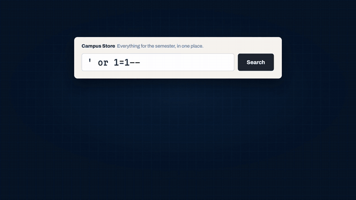</a>

<p align="center"><sub>17-second cut. Click it for the full 70-second explainer with voiceover (<a href="docs/media/attack-shield-explainer.mp4">MP4</a>).</sub></p>

## The four algorithms, live

<table>
<tr>
<td width="50%"></td>
<td width="50%"></td>
</tr>
<tr>
<td><b>Bloom filter</b> answers “definitely not listed” for almost every visitor from a structure far smaller than a hash set. A “possibly” goes to the exact check.</td>
<td><b>Signature trie</b> finds every attack pattern in one pass, and barely slows down as signatures grow. KMP is the baseline it is measured against.</td>
</tr>
<tr>
<td></td>
<td></td>
</tr>
<tr>
<td><b>Segment tree</b> counts requests per second for the last 10 minutes and answers range sums and the peak in O(log n).</td>
<td><b>Edmonds–Karp</b> finds a server network's maximum throughput; the minimum cut is the links a flood saturates first.</td>
</tr>
</table>

## The dashboard

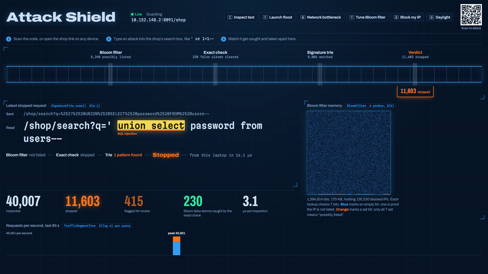

## Run it

**Prerequisites:** JDK 25 or newer (`java -version`). Nothing else: Maven comes with the project (`mvnw`), the
front end is plain JavaScript served by the same server, and fonts and the QR library are bundled, so the demo
works with no internet connection.

```bash
./mvnw spring-boot:run          # Windows: mvnw.cmd spring-boot:run
```

Open <http://localhost:8080> for the dashboard. The demo shop is at <http://localhost:8080/shop/index.html>.

To attack from a phone, put it on the same Wi-Fi and scan the QR code on the dashboard. On Windows, allow
Java through the firewall when asked (or for port 8080 on private networks). The first start takes about a
second while the 135k-address blocklist loads.

### Live demo

A public copy runs at **<https://attack-shield.onrender.com>** (dashboard at `/`, shop at `/shop/index.html`), with the
dashboard opened to everyone. It is a free instance: after 15 idle minutes the first visit takes up to a minute to
wake. Render's edge blocks `' or 1=1--` before it reaches the app, so on the live site try
`union select password`, `<script>alert(1)</script>` or `../../etc/passwd` instead; locally every payload reaches
the shield.

### Configuration

No secrets are needed. Everything has a working default; override with a flag or an environment variable.

| Setting | Default | Environment variable | Meaning |
|---|---|---|---|
| `server.port` | `8080` | `SERVER_PORT` | HTTP port |
| `shield.dashboard.local-only` | `true` | `SHIELD_DASHBOARD_LOCALONLY` | The dashboard API answers only the machine running the server. Other devices can use the shop and block themselves, nothing else. Set `false` to show the dashboard on a second machine. |

```bash
./mvnw spring-boot:run -Dspring-boot.run.arguments="--server.port=9090 --shield.dashboard.local-only=false"
```

## Try it in two minutes

1. Open the shop and search for `' or 1=1--`. You get a "Stopped" page; the dashboard shows the request with
   the matched bytes highlighted.
2. Search for `o'reilly java book`. It passes: an apostrophe alone is not an attack.
3. Press **I** on the dashboard and paste anything, for example the double-encoded
   `/shop/search?q=%2527%2520UNION%2520SELECT%2520password`. The Java pipeline decodes and judges it without
   counting it in the live statistics.
4. Press **F** and launch a 100,000-request flood with known labels: detection rate, false-alarm rate and
   throughput are measured, and the per-second chart spikes.
5. Press **T**, pick a false-positive target and optionally upload a blocklist file (one IP per line). The
   filter is rebuilt and its measured false-positive rate is shown beside the theory.
6. Press **N** to find the bottleneck of a server network; edit the JSON to change capacities.

Keys: **I** inspect, **F** flood, **N** network, **T** tune Bloom filter, **B** block my IP, **D** daylight theme.

## Tests, benchmarks and evaluation

```bash
./mvnw test                                           # 50 unit and API tests, about 15 s
./mvnw test -Dgroups=bench -DexcludedGroups=none      # benchmarks + held-out evaluation, a few minutes
```

- **Unit tests** (`src/test/java/.../algo`): at least five per algorithm, each with a boundary case, plus
  randomized cross-checks against a brute-force or baseline implementation (trie vs KMP vs `indexOf`, segment
  tree vs plain array, max flow = min cut on 200 random networks, Bloom filter: no false negatives, measured
  false-positive rate near target).
- **API tests** (`ApiControllerTest`): every invalid input answered with a 400 and a reason, the local-only rule,
  and a regression test for an encoded-path bypass (`/%73hop`).
- **Benchmarks** (`bench/BenchmarkTest`): three or more input sizes per algorithm against a baseline, 3 warm-up
  + 7 timed runs, median reported. Each experiment first checks that the algorithm and its baseline give the
  same answer. Results go to [`docs/bench/`](docs/bench) as CSV and SVG charts.
- **Held-out evaluation** (`bench/HeldOutEvaluationTest`): detection on public attack payloads and false alarms
  on real text, neither of which the signatures were written from.

## API

All endpoints are under `/api`, take and return JSON, and answer invalid input with
`400 {"error": "<what to fix>"}`.

| Method and path | Body / query | Returns |
|---|---|---|
| `POST /api/inspect` | `{"text": "...", "ip": "optional"}` | Verdict, decoded text, matches with offsets, Bloom probes, timing. Not counted in stats. |
| `POST /api/simulate` | `{"requests": 1..1000000, "attackRatio": 0..1, "seed": optional}` | Labelled flood result: detection rate, false-alarm rate, throughput |
| `POST /api/bottleneck` | `{"nodes": [...], "links": [{"from","to","capacity"}], "source", "sink"}` | Max flow, min-cut links, source side |
| `POST /api/bloom/rebuild` | `{"falsePositiveRate": 0.0001..0.5, "blocklist": "optional file text"}` | Filter size, k, theoretical and measured false-positive rate |
| `POST /api/blocklist` | none | Adds the **caller's own** IP to the blocklist (open to any device) |
| `GET /api/stats` | | Counters, blocklist and filter sizes, average inspection time |
| `GET /api/traffic?seconds=1..600` | | Per-second counts, totals and peak, from the segment trees |
| `GET /api/events` | | Server-Sent Events stream of inspections (dashboard live feed) |
| `GET /api/bloom/bits` | | The filter's raw bit array (for the bit-field view) |

```bash
curl -s localhost:8080/api/inspect -H 'Content-Type: application/json' \
  -d '{"text":"/shop/search?q=%27%20union%20select%20password","ip":"45.148.10.151"}'

curl -s localhost:8080/api/simulate -H 'Content-Type: application/json' \
  -d '{"requests":100000,"attackRatio":0.3,"seed":7}'

curl -s localhost:8080/api/bottleneck -H 'Content-Type: application/json' \
  -d '{"nodes":["internet","lb","app","db"],"links":[{"from":"internet","to":"lb","capacity":9000},{"from":"lb","to":"app","capacity":4000},{"from":"app","to":"db","capacity":1200}],"source":"internet","sink":"db"}'

curl -s 'localhost:8080/api/traffic?seconds=60'
```

## Data

| Data | Where | Source and licence |
|---|---|---|
| Blocklist, 135,530 IPs | `src/main/resources/data/bad-ips.txt` | Snapshot of the [ipsum](https://github.com/stamparm/ipsum) daily feed of malicious IPs, Unlicense (public domain) |
| Attack signatures | `src/main/resources/data/signatures.txt` | Written for this project from the OWASP attack families; format `CATEGORY\|pattern` |
| Held-out attacks | `src/test/resources/eval/attacks/` | [PayloadsAllTheThings](https://github.com/swisskyrepo/PayloadsAllTheThings), MIT, pinned commit; see [`SOURCES.md`](src/test/resources/eval/SOURCES.md) |
| Benign text | `src/test/resources/eval/benign/` | 10,000 random English Wikipedia titles, CC BY-SA 4.0 |
| Flood traffic | generated | `TrafficSimulator`, labelled, seeded |

Sample inputs for the dashboard: any line of the attack files works in the inspect box, and
`src/test/resources/eval/benign/wikipedia-titles.txt` is a representative clean set.

## Layout

```
src/main/java/edu/atlas/shield/
  algo/   BloomFilter, SignatureTrie, Kmp, TrafficSegmentTree, MaxFlow   the assessed algorithms, no Spring
  core/   ShieldEngine (pipeline + verdict policy), TrafficSimulator     application logic
  web/    ApiController, ShieldFilter, LocalOnlyFilter, EventHub, ShopController   HTTP layer
src/main/resources/static/                                                dashboard (plain JS) and shop
src/test/java/edu/atlas/shield/                                           unit, API, benchmark and evaluation tests
docs/   REPORT.md, PROPOSAL.md, bench/ (CSV + SVG results), screenshots/,
        readme/ (the animated SVGs on this page), media/ (explainer video and trailer)
```

## Screenshots

| Inspect any text | Tune the Bloom filter | Network bottleneck |
|---|---|---|
| 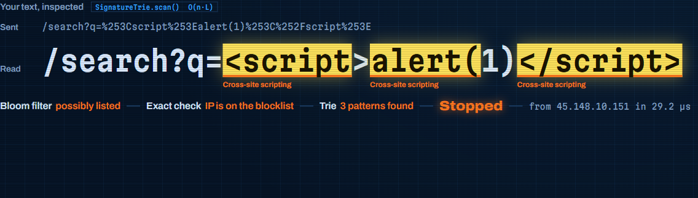 | 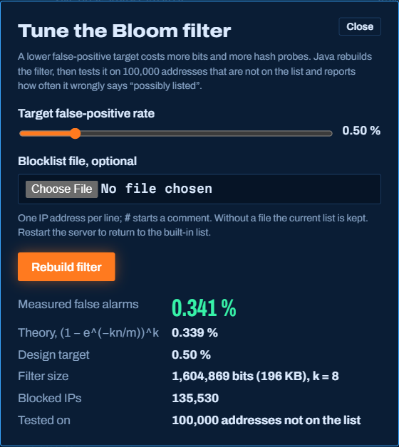 | 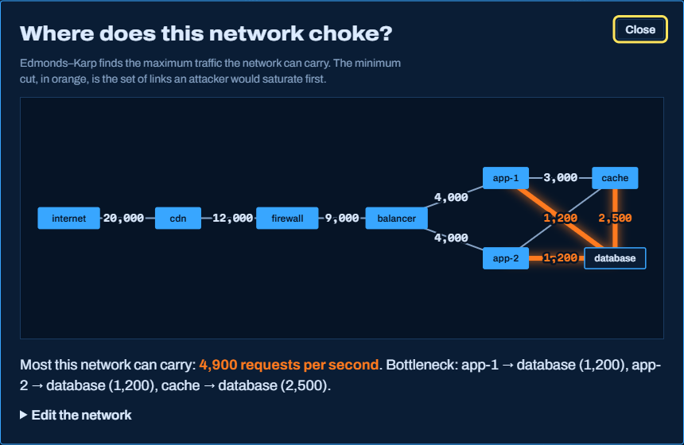 |

## Author

Arjun Nair: individual submission (all design, code, tests and documentation).
