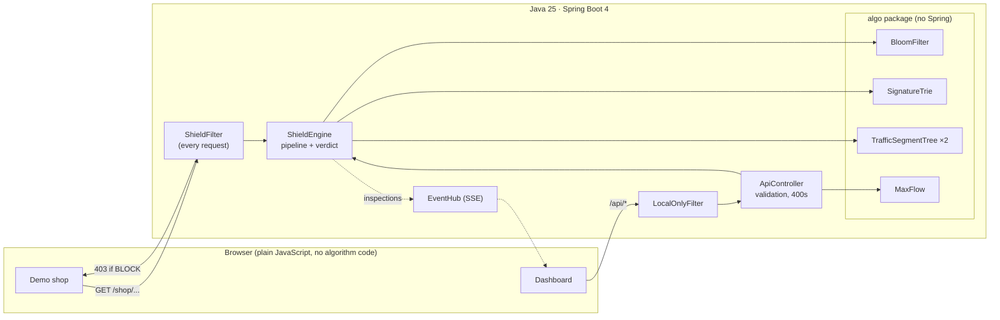
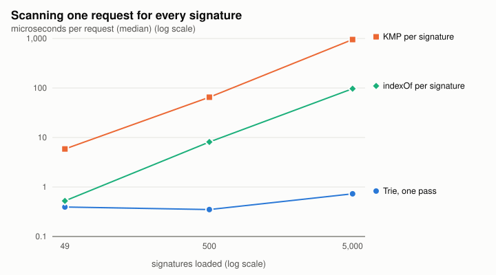
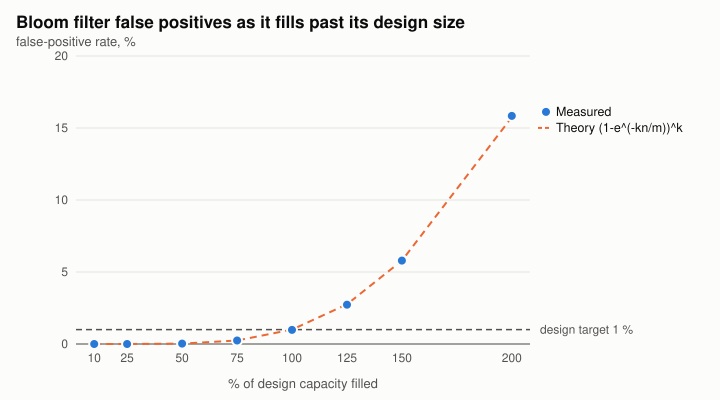
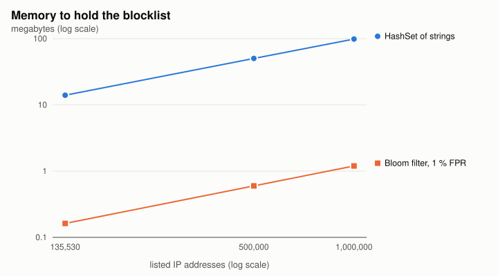
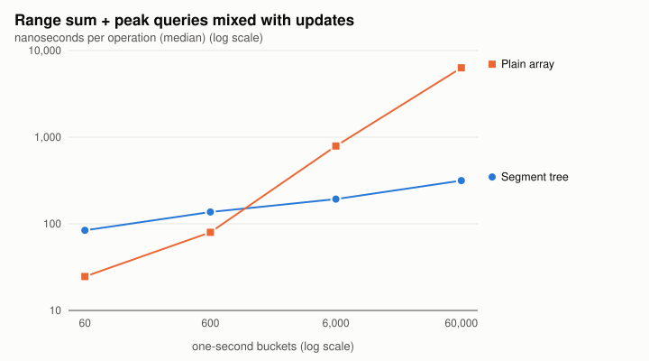

# Attack Shield: technical report

**Course:** Advanced Algorithms, CIA 3 · B.Tech CS AI & ML, Semester V · ATLAS uGDX, 2026–27
**Author:** Arjun Nair (individual submission). Every number below can be reproduced with the commands in §9.

## 1. Problem

Any small web service on the internet, such as a campus store, is probed by automated scanners within minutes of going
online. They try SQL injection in search boxes, script injection in product IDs and `../../etc/passwd` in paths, and
they send requests from addresses already on public abuse feeds. A small team cannot afford a commercial web
application firewall, but it can put a filter in front of its application if the filter is **fast enough for every
request**, **never blocks innocent users because of a probabilistic error**, and **explains every decision**.

**Users.** The operator of a small service (for example a campus IT administrator), who needs requests screened and
wants to see why each one was stopped; and a security instructor, who uses the live dashboard to show real attacks
being caught. The dashboard shows each stopped request as sent and as decoded, the exact bytes that matched, and which
pipeline stage decided (§3). A second tool uses max-flow / min-cut to find the bottleneck of a server network.

## 2. Constraints, assumptions and success criteria

| Input | Constraint | Enforced by |
|---|---|---|
| Request line (path + query) | ≤ 8,192 characters | Tomcat for live traffic; `/api/inspect` returns 400 above it |
| Source IP | IPv4 or IPv6 literal | `ShieldEngine.isIp`, otherwise 400 |
| Blocklist | 135,530 IPs built in; an upload is ≤ 10 MB, one IP per line | `parseBlocklist`: one bad line rejects the file, citing its line number |
| Bloom target false-positive rate | 0.01 % – 50 % | 400 outside that range |
| Max-flow network | ≤ 500 nodes, ≤ 5,000 links, capacities ≥ 0, total flow < 2^63 | 400 with a reason; overflow is detected, never wrapped |
| Traffic window | 1 – 600 one-second buckets | 400 outside that range |

**Assumptions.** (a) Attacks arrive in the URL (path and query); headers and bodies are out of scope (§8). (b) An
attacker may URL-encode a payload once or twice, and that must not hide it. (c) The blocklist is authoritative: a
listed address is blocked, even if it is a shared NAT address (§8). (d) Most traffic is benign and comes from unlisted
addresses, which is what makes a Bloom precheck worthwhile.

| # | Success criterion | Target | Measured | Met |
|---|---|---|---|---|
| S1 | Blocklisted IPs missed | 0 | 0 in 3 × 1,000,000 lookups (§6.2); 0 of 10,000 in unit tests | yes |
| S2 | Requests blocked because of a Bloom false positive | 0 | every hit is confirmed exactly; matches a plain `HashSet` on all 3,000,000 lookups | yes |
| S3 | Bloom false-positive rate vs theory, up to capacity | within 0.1 points | 0.98 % vs 1.00 % at capacity; 0.341 % vs 0.339 % on the real list at a 0.5 % target | yes |
| S4 | Scan cost as signatures grow from 49 to 5,000 | flat | trie 0.39 → 0.73 µs per request; KMP 5.9 → 954 µs (§6.1) | yes |
| S5 | Mean pipeline latency | ≤ 10 µs | 3.1 µs over a 40,007-request run | yes |
| S6 | False alarms on real benign text | < 1 % | 0 of 10,000 Wikipedia titles (95 % upper bound 0.03 %) | yes |
| S7 | Detection on payloads the signatures were not written from | report honestly | 58.9 % of 1,672 (§7) | reported |
| S8 | Traffic query cost as the window grows | O(log n) | 316 ns per operation at 60,000 buckets vs 6,322 ns for an array scan | yes |

## 3. System design



`algo` holds the assessed algorithms as plain Java with no framework dependencies, so they can be tested and
benchmarked in isolation. `core` holds the pipeline order, URL normalisation, the verdict policy and the traffic ring
buffer. `web` holds HTTP concerns: validation, error mapping, the servlet filters and the event stream. The browser
only displays results. Every verdict, match offset, Bloom bit, traffic count and flow value is computed in Java.

**Request flow.** `ShieldFilter` runs before Spring's dispatcher and calls `ShieldEngine.inspect(ip, rawRequestLine)`:

1. **Normalise:** URL-decode up to twice (`%2527` → `%27` → `'`), then lower-case. A malformed escape is kept as-is
   instead of throwing. Two rounds undo the common double-encoding trick while keeping the work bounded.
2. **Bloom precheck** on the source IP. A miss means the IP is definitely not listed.
3. **Exact check**, only on a Bloom hit: a `HashSet` lookup rules out a false positive.
4. **Trie scan** of the normalised text, which returns every signature occurrence with its offset and category.
5. **Verdict policy.** An exploit signature or a confirmed listed IP gives BLOCK. A scanner probe on its own (for
   example `/wp-admin`) only gives FLAG, because blocking reconnaissance risks locking out curious users for little
   gain. Anything else gives ALLOW. A BLOCK is answered with 403, and the shop never sees the request.
6. **Count** the request into the current one-second bucket of two segment trees (all requests, and blocked ones).

The README documents the nine API endpoints with curl examples. Every invalid input gets `400 {"error": "..."}`.

## 4. Algorithms

### 4.1 Bloom filter (Unit 6, CO5): blocklist precheck

**Why.** About 99 % of requests come from unlisted addresses. A Bloom filter answers "definitely not listed" for
almost all of them in k bit probes, from a structure about 85 times smaller than the exact set (§6.2). It never misses
a listed address. Its only error, "possibly listed" for an unlisted address, is removed by the exact check.

```
construct(n, p):   m ← ⌈−n·ln p / (ln 2)²⌉ bits;   k ← round((m/n)·ln 2)
add(x):            h ← hash64(x); h1 ← low 32 bits; h2 ← (high 32 bits) OR 1
                   for i in 0..k−1: set bit (h1 + i·h2) mod m
mightContain(x):   for i in 0..k−1: if bit (h1 + i·h2) mod m = 0: return false   // definitely absent
                   return true                                                     // possibly present
```

For the 135,530-address list plus 10,000 addresses of headroom for runtime additions (n = 145,530, p = 1 %), this
gives m = 1,394,914 bits (170 KB) and k = 7. `hash64` is FNV-1a followed by the SplitMix64 finaliser. The k indexes
come from Kirsch–Mitzenmacher double hashing, which keeps the asymptotic false-positive rate of k independent hashes.
Making h2 odd stops the probes collapsing onto a single bit.

**Correctness.** *No false negatives:* `add(x)` sets exactly the bits that `mightContain(x)` reads, and bits are never
cleared, so a member always finds all k bits set. Tests check that the probe positions equal the bits set, and that
10,000 inserted items are all found. *False-positive rate:* after n insertions a given bit is still 0 with probability
(1 − 1/m)^{kn} ≈ e^{−kn/m}, so a non-member passes all k probes with probability (1 − e^{−kn/m})^k, assuming uniform,
independent hashing. §6.3 shows the measured rate matching this formula from 10 % to 200 % of capacity, which is
evidence that the assumption holds for this hash on IP strings. The live list fills the filter to 93 %, so its
theoretical rate is 0.71 %.

### 4.2 Signature trie (Unit 4): multi-pattern scan

**Why.** The shield must find any of S signatures in every request. Searching for each one separately (KMP or
`indexOf`) costs O(S·n) per request and grows with every signature added. A trie of all signatures, walked from each
start position, finds them all in one pass. Its cost depends on the text length and the longest signature, not on S.

```
add(sig, cat):  walk/create one node per character; mark the last node with (sig, cat)
scan(text):     for start in 0..|text|−1:
                    node ← root
                    for i in start..|text|−1:
                        node ← node.child[text[i]];  if node = null: break
                        if node is marked: report (node.sig, node.cat, start)
```

**Correctness.** *Completeness:* if s occurs at j, the walk from j reads s's characters along edges that `add(s)`
created, and reaches s's marked node, so (s, j) is reported. *Soundness:* the walk from j reaches a node only by
reading exactly the characters on its path, so a report (s, j) means `text[j..j+|s|)` equals s. Overlapping and nested
matches are all reported. A unit test checks both properties against KMP on random text (KMP is itself tested against
`String.indexOf`), and §6.1 repeats the check on 2,000 requests × 3 signature sets: all three methods find the same
592 matches.

**Baseline: KMP (Unit 4).** The prefix function π[i] is the length of the longest proper prefix of p[0..i] that is
also its suffix. On a mismatch the search falls back to π instead of re-reading text, so one pattern costs O(n + |p|).

### 4.3 Segment tree (Unit 3): traffic window

**Why.** Each second, the dashboard asks for the request count over the last 10 s and 60 s and for the peak second,
while every request updates a bucket. A segment tree over the 600-bucket ring answers both kinds of question in
O(log n).

```
update(i, v):  leaf[i] ← v; for each ancestor: sum ← sum(left) + sum(right);
                                               maxIdx ← leaf[maxIdx(right)] > leaf[maxIdx(left)] ? maxIdx(right) : maxIdx(left)
sum(l, r), argMax(l, r):  standard range decomposition into O(log n) nodes, combined with the same rule
window(s):     [now − s + 1, now] is one ring range, or two if it wraps
```

**Correctness.** Invariant: every node holds the sum and the leftmost-maximum index of its range. `build` establishes
it, and `update` restores it on the only path that changed. A query combines O(log n) disjoint nodes that exactly
cover [l, r]. Before counting, the ring zeroes every bucket skipped since the last request, so no bucket carries counts
from 600 s ago. Tests compare `sum` and `argMax` with brute force under random updates, including ties and single
buckets; §6.4 repeats the comparison on 100,000 operations at four sizes.

### 4.4 Edmonds–Karp max-flow and min cut (Unit 5): network bottleneck

**Why.** The links behind the shop (CDN → firewall → load balancer → app servers → cache/database) have capacities in
requests per second. The maximum flow is the most traffic the network can carry. By the max-flow min-cut theorem, the
minimum cut is the set of links that limits it: the bottleneck to reinforce, and the links a flood saturates first.

```
solve(s, t):  residual ← capacities; flow ← 0
              while BFS finds a shortest s→t path P in the residual graph:
                  push ← min residual capacity on P
                  for e on P: residual[e] −= push; residual[reverse(e)] += push
                  if push > LONG_MAX − flow: reject input            // overflow guard
                  flow += push
              S ← nodes reached by the last (failed) BFS
              minCut ← original edges (u, v) with u ∈ S, v ∉ S
```

**Correctness.** Every augmentation preserves the capacity and conservation constraints. When no augmenting path is
left, every original edge leaving S is saturated and every edge entering S carries no flow, so the flow equals that
cut's capacity; by weak duality both are optimal. Because BFS picks **shortest** paths, every node's distance from s
never decreases, so each edge is the bottleneck at most O(V) times. That bounds the augmentations by O(VE),
*whatever the capacities*. Tests cover:

- the CLRS Fig. 26.1 network (flow 23);
- flow equal to cut capacity on 200 random networks;
- disconnected and parallel-link cases;
- invalid input;
- totals beyond 2^63.

The last case was a real bug found during this work: two `Long.MAX_VALUE` links returned −2.

## 5. Complexity summary

| Component | Time | Space |
|---|---|---|
| Bloom add / query | O(k), k = 7 | m = 1.39 M bits (170 KB) |
| Exact confirmation (`HashSet`) | O(1) expected, only on Bloom hits (≈ 2 %) | O(n) strings (≈ 14 MB) |
| Trie build / scan | O(Σ\|s\|) / O(n·L), L = longest signature = 18 | O(Σ\|s\|) |
| KMP baseline, one pattern | O(n + \|p\|) | O(\|p\|) |
| Segment tree update / range query | O(log n) / O(log n) | O(n) |
| Edmonds–Karp | O(V·E²), at most O(VE) augmentations | O(V + E) |
| Whole inspection | O(L·\|url\| + k) | the result only |

## 6. Experimental evaluation

**Method.** `BenchmarkTest` runs each measurement 3 times to warm up the JIT and 7 times timed, and reports the median
(min and max are in the CSVs). Inputs come from fixed seeds. Before any timing, each experiment asserts that the
algorithm and its baseline give identical answers, so no speed-up comes from a wrong result. Machine: Intel Core Ultra
7 155H (16 cores), 15 GB RAM, Windows 11, OpenJDK 26 (Temurin). These are wall-clock times on a laptop: the growth
rates and ratios carry the conclusions, not the absolute numbers. Raw data is in `docs/bench/`.

<p>




</p>

*Figure 1: signature scan (§6.1), Bloom false-positive rate (§6.3), memory (§6.2) and segment tree (§6.4). All axes are
logarithmic except in the false-positive chart.*

### 6.1 Signature scan: trie vs KMP vs `indexOf`

2,000 realistic request lines (30 % carrying a real signature, some URL-encoded), scanned against the 49 real
signatures plus synthetic ones up to 500 and 5,000.

| Signatures | Trie (one pass) | KMP per signature | `indexOf` per signature | Trie vs `indexOf` |
|---|---|---|---|---|
| 49 | **0.39 µs** | 5.85 µs | 0.52 µs | 1.3× |
| 500 | **0.35 µs** | 65.2 µs | 8.11 µs | 23× |
| 5,000 | **0.73 µs** | 954 µs | 97.0 µs | 133× |

The trie stays flat while both baselines grow linearly, as O(n·L) vs O(S·n) predicts. With 49 signatures the gap to
`indexOf` is small, because `indexOf` is a vectorised JVM intrinsic: the trie's advantage is that it scales. KMP is the
slowest despite its O(n + m) bound, because building a prefix table for every short pattern costs more than the naive
comparisons it saves on 50-character texts. Its value is the worst-case guarantee, not speed on short inputs.

### 6.2 Bloom precheck vs exact `HashSet`

1,000,000 lookups (99 % unlisted, the normal case) at three list sizes.

| Listed IPs | `HashSet` only | Bloom alone | Bloom then exact | `HashSet` memory | Bloom memory | Exact lookups needed |
|---|---|---|---|---|---|---|
| 135,530 | 28.6 ns | 60.8 ns | 61.3 ns | 14.0 MB | 0.16 MB | 19,917 (2.0 %) |
| 500,000 | 35.7 ns | 54.1 ns | 54.8 ns | 50.3 MB | 0.60 MB | 19,970 (2.0 %) |
| 1,000,000 | 35.5 ns | 63.6 ns | 68.0 ns | 98.5 MB | 1.20 MB | 19,995 (2.0 %) |

**Where it does not help:** inside one process, a `HashSet` lookup is about twice as fast, and keeping both structures
uses slightly *more* memory than the set alone. **Where it helps:** the filter is 82–86 times smaller and removes 98 %
of exact lookups. When the authoritative list is expensive to reach, for example in a database, on another server, or
on a memory-limited edge node, a million remote lookups become about 20,000. That is the deployment the filter is
designed for. In this demo the exact set is local, so the filter is there to demonstrate that design, not to speed
things up. (`HashSet` memory is approximate: the heap difference before and after building it.)

### 6.3 Bloom false-positive rate vs theory (CO5)

A filter designed for 100,000 items at 1 % is filled to between 10 % and 200 % of capacity. Each fill level is probed
with 200,000 non-members.

| Fill | 10 % | 25 % | 50 % | 75 % | 100 % | 125 % | 150 % | 200 % |
|---|---|---|---|---|---|---|---|---|
| Measured | 0.00 % | 0.00 % | 0.03 % | 0.24 % | **0.98 %** | 2.73 % | 5.79 % | 15.84 % |
| Theory | 0.00 % | 0.00 % | 0.03 % | 0.24 % | **1.00 %** | 2.76 % | 5.79 % | 15.75 % |

Measured and theoretical rates agree within 0.1 points at every fill level. The filter keeps its sizing promise up to
capacity and degrades predictably beyond it: at double the design size, one non-member in six reaches the exact
check. That is why the engine keeps headroom, and why `/api/bloom/rebuild` can re-size the filter. On the real list,
rebuilding for a 0.5 % target gave 0.341 % measured vs 0.339 % theory (100,000 probes).

### 6.4 Segment tree vs plain array

100,000 operations: half point updates, half queries for a range sum and the range's peak bucket.

| Buckets | 60 | 600 | 6,000 | 60,000 |
|---|---|---|---|---|
| Segment tree | 84 ns | 137 ns | 193 ns | 316 ns |
| Plain array | **25 ns** | **80 ns** | 791 ns | 6,322 ns |

**The crossover is inconvenient, and we report it as it is.** At the app's own size of 600 buckets, the plain array is
faster (80 vs 137 ns), because scanning a few hundred contiguous longs is cache-friendly and predictable. The tree wins
somewhere between 600 and 6,000 buckets and is 20× faster at 60,000. Both curves grow as theory predicts, logarithmic
vs linear. The tree is still the right structure: its cost stays bounded however long a window an operator asks for,
so the same code would serve an hour or a day per second. At 600 buckets, the dashboard's two queries per second cost
microseconds either way.

### 6.5 Edmonds–Karp vs DFS Ford–Fulkerson

The test networks are random: a chain from s to t plus 4 random links per node. Capacities go up to 10 in the first
set and up to 1,000,000 in the second. The DFS baseline has a 60-second budget.

| Nodes | Max capacity | EK paths | EK time | DFS-FF paths | DFS-FF time |
|---|---|---|---|---|---|
| 100 | 10 | 8 | 0.45 ms | 9 | 0.47 ms |
| 1,000 | 10 | 27 | 6.1 ms | 46 | 5.0 ms |
| 10,000 | 10 | 21 | 35 ms | 33 | 35 ms |
| 100 | 1,000,000 | 9 | 0.02 ms | 166 | 0.43 ms |
| 1,000 | 1,000,000 | **25** | **2.2 ms** | **759,135** | **26.6 s** |
| 10,000 | 1,000,000 | **5** | **8.6 ms** | ≥ 116,963 | **did not finish in 60 s** |

With small capacities the two are equivalent; DFS is even slightly faster at 1,000 nodes. With large capacities, DFS
Ford–Fulkerson's path count follows the capacities (bound O(E·|f\*|)) and explodes to 759,135 paths and 26.6 s,
against 25 paths and 2.2 ms for Edmonds–Karp, whose count depends only on the graph (O(VE)). Capacities in requests per
second are naturally in the thousands to millions, which is why this application uses Edmonds–Karp.

## 7. Detection quality

The built-in flood generator builds its attacks from the signature list itself. It therefore measures throughput and
plumbing, not recognition: its near-100 % detection is circular, and the dashboard says so. `HeldOutEvaluationTest`
uses data the signatures were **not** written from. Each input is sent the way a browser sends a search
(`/shop/search?q=<URL-encoded>`) from an unlisted address, so only the trie can catch it.

| Set | Inputs | Stopped | Rate |
|---|---|---|---|
| XSS (PayloadsAllTheThings) | 238 | 201 | 84.5 % |
| Path traversal | 140 | 116 | 82.9 % |
| SQL injection | 763 | 538 | 70.5 % |
| Command injection | 531 | 130 | 24.5 % |
| **All attacks** | **1,672** | **985** | **58.9 %** |
| Benign: 10,000 random Wikipedia titles as searches | 10,000 | 0 | **0 % false alarms** |

The 687 misses are listed in `docs/bench/held-out-missed.csv`. Most command-injection misses are fragments such as
`;id`, `|id|` or a lone backtick. The signatures deliberately require more context (`; cat`, `/bin/sh`), because a bare
`;` or `|` appears in innocent text. SQL-injection misses are mostly forms the signatures do not cover:

- column probes such as `ORDER BY 12--`;
- bare boolean probes such as `AND 1=0`;
- tautologies that avoid `1=1`, such as `' or true--` and `' or 'x'='x`.

Zero false alarms in 10,000 real titles puts the true false-alarm rate below 0.03 % with 95 % confidence (rule of
three). The signatures were **not** tuned on this set, because that would make it circular too.

## 8. Failure handling and limitations

**Handled edge cases** (each tested). Empty or malformed JSON and missing fields get a 400 with a reason. A blocklist
upload with a bad line is rejected with its line number; comment-only files are rejected; duplicates are counted and
ignored. Unknown or duplicate nodes, null links, negative capacities and source = sink get a 400. A disconnected network
gives flow 0 and an empty cut, not an error. A total flow beyond 2^63 is a 400; it used to be a wrong negative answer.
Malformed `%` escapes are scanned as text instead of crashing. The encoded path `/%73hop` is still inspected (a
regression test for a bypass found earlier). An over-full Bloom filter raises false positives as §6.3 predicts, while
the exact check keeps verdicts correct.

**Limitations.**

1. **Recall ceiling.** 58.9 % on held-out payloads. Obfuscation beyond URL decoding (SQL comments, concatenation, HTML
   entities, Unicode) defeats fixed substrings. More signatures would help, but they should be tuned on a separate
   development set, keeping this one held out.
2. **Only the URL is inspected.** Headers (where Log4Shell usually travels) and POST bodies are not scanned; the same
   trie would cover them.
3. **Blocklists are blunt.** A listed shared NAT or mobile-carrier address blocks every innocent user behind it.
   Choosing FLAG instead of BLOCK for listed IPs would be the gentler policy.
4. **The scan is O(n·L), not O(n).** Aho–Corasick failure links would make it linear; that was unnecessary with
   18-character signatures.
5. **One global lock** serialises inspections. At a 3.1 µs mean that allows about 300,000 requests per second, far
   above this deployment's needs; striped counters would remove the lock.
6. **In-memory state.** A restart resets the counters and any runtime blocklist changes.
7. **One machine.** Absolute times vary between machines; the conclusions rest on the ratios and growth rates.

## 9. Reproducing the results, data, and contribution

```bash
./mvnw test                                         # 50 unit and API tests
./mvnw test -Dgroups=bench -DexcludedGroups=none    # §6 and §7 (several minutes, mostly the DFS baseline)
```

**Data and licences.** The blocklist is a snapshot of the ipsum feed (Unlicense). The held-out attacks come from
PayloadsAllTheThings (MIT, pinned commit), and the benign titles from Wikipedia (CC BY-SA 4.0). Details are in
`src/test/resources/eval/SOURCES.md`.

**Individual contribution.** This is an individual submission, and all of the work is mine: the problem
formulation, the algorithm implementations and tests, the pipeline and API, the dashboard and shop, the benchmark and
evaluation harnesses, and this report. Each change is recorded as a separate pull request in the Git history.
